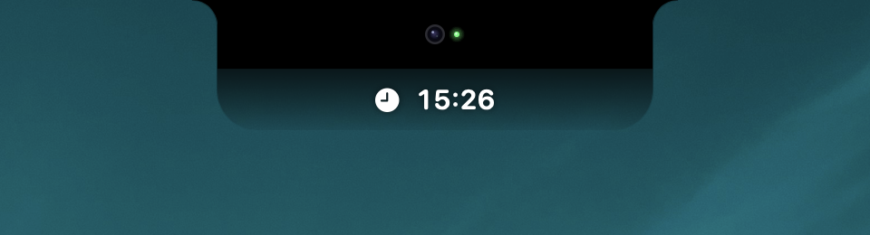
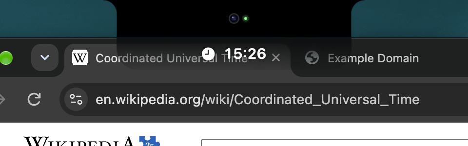
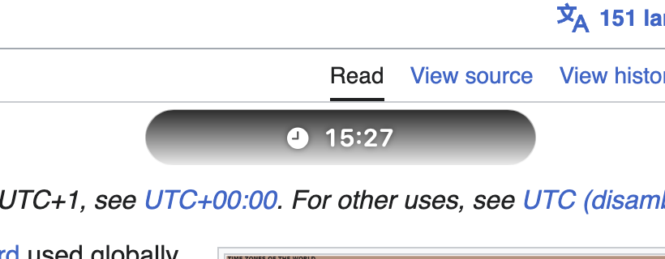
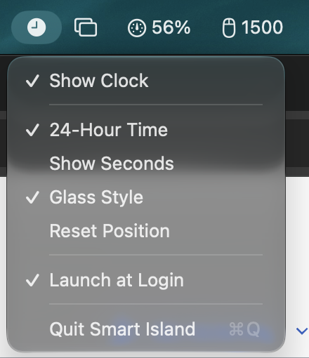

# Smart Island

A thin clock that sits right under the MacBook notch, so you can check the time while you keep looking at the camera on a video call.



<sub>macOS screenshots don't include the notch hardware, so the camera lens and green light are drawn in to show how it looks on the real screen.</sub>

Most of the time on a Zoom call your eyes drift to the top-right corner to check the clock, which looks like you've stopped paying attention. Smart Island puts the time just below the webcam instead, as a small extension of the notch, so a glance at the clock still reads as eye contact.

## Features

- **Merges into the notch.** The island is solid black across the menu bar, so it looks like part of the notch, with a dark Liquid Glass strip below it that fades out toward the bottom.
- **Built-in screen only.** It appears on the MacBook's own display and never on an external monitor.
- **Always there.** It stays visible on every desktop (Space) and over full-screen apps.
- **Clicks pass through.** The island never gets in the way: clicks land on the window underneath, so you can still use browser tabs or toolbars behind it.
- **Movable.** Hold ⌘ and drag to move it anywhere on the built-in screen; it becomes a floating pill. ⌘ double-click, or **Reset Position** in the menu, snaps it back under the notch.
- **Menu bar controls.** A clock icon in the menu bar holds all the settings.

| Over browser tabs (click-through) | Dragged away with ⌘ |
|---|---|
|  |  |



### Menu bar options

- **Show Clock**: hide or show the island.
- **24-Hour Time**: switch between 24-hour (default) and 12-hour time.
- **Show Seconds**: add seconds to the time.
- **Glass Style**: the fading Liquid Glass strip (default), or turn it off for solid black.
- **Reset Position**: put the island back under the notch.
- **Launch at Login**: start Smart Island when you log in.
- **Quit Smart Island**

Smart Island has no Dock icon; the menu bar icon is the way to reach it.

<br clear="right">

## Requirements

- A Mac with a built-in display. It's designed for MacBooks with a notch; on a Mac without one it uses a standard notch size.
- macOS 14 Sonoma or later. The Liquid Glass style needs macOS 26 Tahoe; on earlier versions the island is solid black.
- Xcode 15 or later, or the Xcode Command Line Tools (`xcode-select --install`), to build it.

## Install

There's no prebuilt download yet, so you build it yourself. It takes about a minute.

```sh
git clone https://github.com/markespiritu/macos-smart-island.git
cd macos-smart-island
./scripts/build-app.sh --install
```

This builds `Smart Island.app`, copies it to `/Applications` and launches it. Run the same command again to update after a `git pull`.

To build without installing, run `./scripts/build-app.sh` and the app lands in `build/Smart Island.app`.

The app is signed ad hoc for your own Mac, which is all a local build needs. **Launch at Login** works best from `/Applications`, so use `--install` for everyday use.

## Usage

- The island appears under the notch as soon as the app starts.
- To move it, hold ⌘, then drag it. Without ⌘, the mouse goes straight through to whatever is underneath.
- To put it back, ⌘ double-click it or choose **Reset Position**. Dropping it near the notch also snaps it back.
- To quit, use **Quit Smart Island** in the menu bar icon.

## Development

```sh
swift run
```

Or open `Package.swift` in Xcode and press Run. Launch at Login only works from the built `.app`.

The strip's height, corner radii, glass tint and fade, font size, move modifier and fallback notch width are all in `IslandMetrics` in `Sources/SmartIsland/ClockView.swift`.
